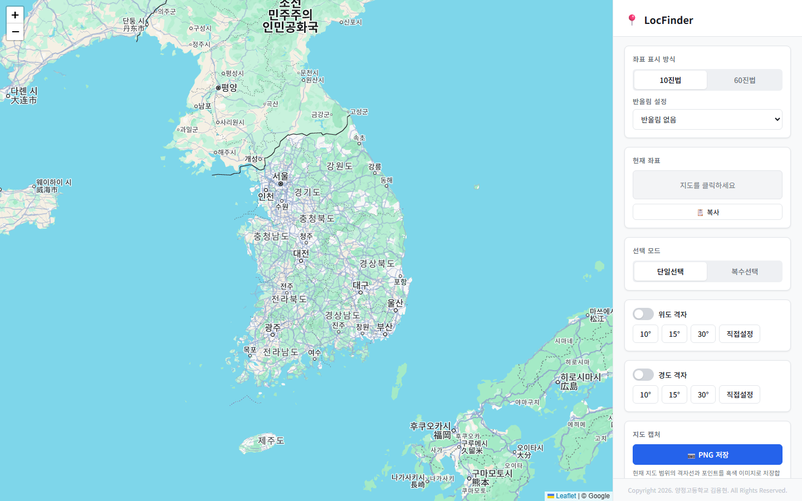

# 좌표 찾기 도구 (LocFinder)

지도를 클릭해 위도와 경도를 읽고, 격자선과 함께 흑백 지도 그림으로 저장하는 웹 도구입니다. 지리 수업 자료나 문제에 쓸 위치 그림을 빠르게 만들려는 선생님을 위해 만들었습니다. 설치 없이 브라우저에서 바로 씁니다.

바로가기: https://locfinder.bgnl.kr



## 할 수 있는 일

- **좌표 읽기**: 지도를 클릭하면 그 지점의 위도와 경도를 보여 주고, 버튼 하나로 복사합니다.
- **10진법과 60진법**: 37.5°N 같은 10진 표기와 37°30'00"N 같은 도분초 표기를 고릅니다.
- **반올림 설정**: 10진법은 1°부터 0.00001°까지, 60진법은 1초부터 0.01초까지 반올림 단위를 정합니다. 클릭한 점도 그 단위의 가장 가까운 격자점으로 맞춰집니다.
- **여러 점 고르기**: 복수선택 모드에서 여러 지점을 찍어 목록으로 모으고, CSV 파일로 내려받습니다.
- **위도, 경도 격자**: 10°, 15°, 30° 간격이나 직접 정한 간격으로 격자선을 켜고 끕니다.
- **PNG 저장**: 지금 보이는 범위의 격자선과 점을 흑백 그림으로 저장합니다. 격자 숫자 위치(좌우, 위아래), 좌표 라벨 표시와 크기, 점 기호((가)(나)(다), ㉠㉡㉢)와 크기, 세계 지도 윤곽선 표시를 정하고 미리보기로 확인한 뒤 저장합니다.
- **휴대폰 대응**: 좁은 화면에서는 오른쪽 설정 창이 햄버거 버튼으로 접힙니다.

## 여는 법

바로가기 주소로 들어가면 됩니다. 내려받아 쓰려면 `index.html`을 브라우저로 열면 됩니다. 배경 지도와 라이브러리를 인터넷에서 불러오므로 인터넷 연결이 필요합니다.

배포는 Vercel이 맡습니다. 기본 브랜치(`master`)에 푸시하면 https://locfinder.bgnl.kr 에 반영됩니다.

## 파일 구성

```
LocFinder/
├── index.html         # 앱 전체 (HTML, CSS, JavaScript 한 파일)
├── LocFinder.html     # index.html과 같은 내용의 사본
├── CNAME              # 사용자 도메인 locfinder.bgnl.kr
└── docs/images/       # README 그림
```

## 자료 출처

- 배경 지도: Google 지도 타일
- PNG 저장의 세계 지도 윤곽선: Natural Earth 1:50m 경계(world-atlas 패키지)
- 지도 라이브러리: Leaflet, topojson-client

## 만든 사람

양정고등학교 지리교사 김용현  
문의: bgnlkim@gmail.com
